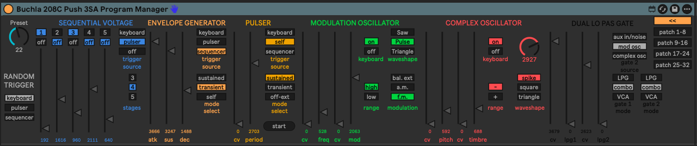
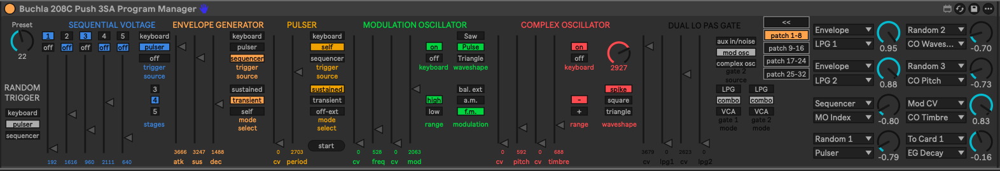

# Buchla 208C Max for Live Controller

A robust Max for Live (M4L) device designed to seamlessly integrate the Buchla 208C with Ableton Live and the Push 3 (Standalone).

This controller provides comprehensive access to the 208C's front panel via deep SysEx control. It is specifically engineered to handle the Buchla's unique hybrid analog/digital workflow, accurately modelling physical banana-cable behaviour, and safely managing SysEx data floods to ensure your UI and hardware stay perfectly in sync.

## Hardware Requirement: The physical Buchla Program Manager card is strictly required for MIDI/SysEx communication between this device and the 208C hardware.

## Key Features
* **Push 3 Standalone Optimised: Fully un-grouped UI architecture ensures all parameters and 32 patch cables read distinctly on the Push 3 screen without parameter mirroring.
* **Massive Virtual Patchbay Array: 32 independent patchbay entries organised cleanly across 4 tabbed, expandable pages. Each cable features Source, Destination, and Level controls.
* **Authentic Hardware UI: Tab states and vertical slider layouts have been explicitly inverted and scaled to visually match the physical 208C front panel (e.g., MO Range, MO Keyboard).
* **Startup Protection & Silent Routing: A global 500ms initialisation gate strictly blocks Ableton's native parameter-loading spam, while carefully timed data streams allow seamless cable rewiring without SysEx feedback loops.
* **Hybrid Preset Management: Built to complement the hardware's physical constraints. Recalling a preset via the Program Manager card instantly syncs tactile switches and knobs, while safely preserving your virtual patchbay cables just like real analog hardware.

## Installation
1. Download the latest .amxd file from the Releases page.
2. Ensure your Buchla Program Manager card is installed and connected via USB.
3. Drag and drop the device onto a MIDI track in Ableton Live.
4. Set the track's MIDI To and MIDI From to your Buchla 208C.
5. (Optional but recommended) Save the device to your User Library under MIDI Effects > Max MIDI Effect for easy access.

