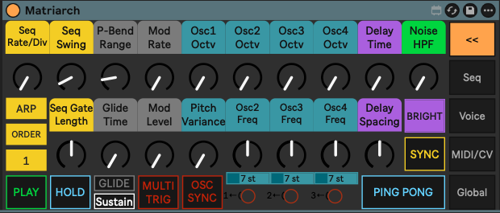
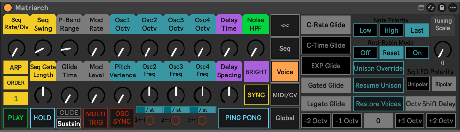
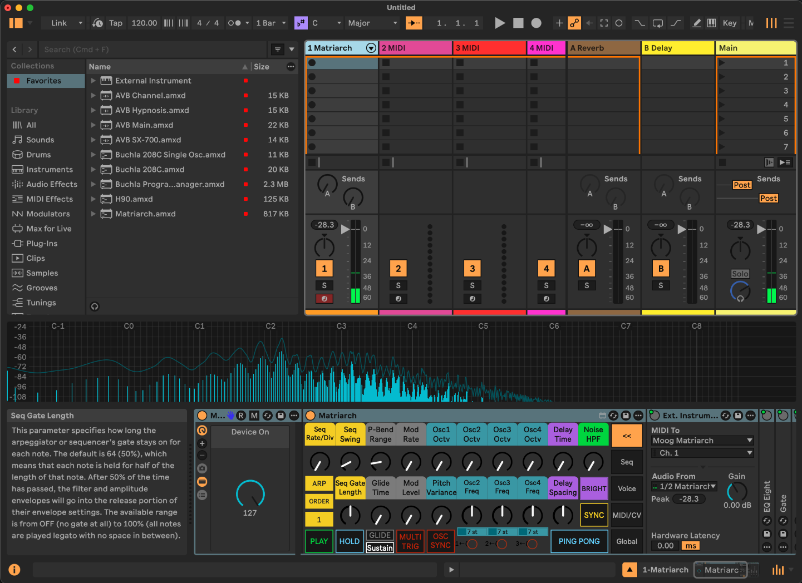

# Moog Matriarch Max for Live Editor

A robust, bidirectional Max for Live (M4L) device designed to seamlessly integrate the Moog Matriarch with Ableton Live and the Push 3 (Standalone). 

This editor provides comprehensive access to the Matriarch's front panel and under-the-hood Global Parameters. It is specifically engineered to handle the Matriarch's unique hardware quirks, accurately parsing 14-bit high-resolution MIDI CCs, translating complex SysEx commands, and working around native firmware bugs to ensure your UI and hardware stay perfectly in sync.

## Key Features
* **Push 3 Standalone Optimized:** All parameters are logically mapped across 9 parameter banks, with UI elements configured to display cleanly on the Push 3 screen.
* **True Bidirectional Sync:** Turning a physical knob on the Matriarch instantly updates Ableton, and adjusting a parameter in Live or on the Push seamlessly controls the synth without MIDI feedback loops.
* **14-Bit Precision:** Flawless 14-bit MIDI CC handling for high-resolution analog parameters like Delay Time and Oscillator Frequencies.
* **SysEx Global Control:** A dedicated fold-out section to manage the Matriarch's hidden Global Settings without needing to navigate physical keybed menu diving.
* **Firmware Bug Workarounds:** Built-in math and routing to handle Moog's non-standard MIDI switch behaviors and prevent MIDI flooding.

## Installation
1. Download the latest `.amxd` file from the Releases page.
2. Drag and drop the device onto a MIDI track in Ableton Live.
3. Set the track's **MIDI To** and **MIDI From** to your Moog Matriarch.
4. *(Optional but recommended)* Save the device to your User Library under `MIDI Effects > Max MIDI Effect` for easy access.

---

## Release History

## v1.3.3: Compact UI Overhaul & Sustain Filter Toggle (Latest)

### ✨ UI & Workflow Enhancements
* **New Compact View:** The device UI has been completely redesigned to save valuable screen real estate in Ableton Live. By default, the device now boots in a compact state, displaying only the essential performance controls.
* **Expandable Tabbed Settings:** Deep device configuration has been moved into a sliding, expandable window. Simply click the new navigation tabs (Seq, Voice, MIDI, Global) to reveal these advanced settings, and click `<<` to snap the device shut when you are done. 

### 🐛 Bug Fixes & Hardware Compatibility
* **Sustain (CC 64) Input Toggle:** Added a dedicated switch in the Global tab to allow or block incoming MIDI CC 64 messages. 
  * *Context:* This reverses the hard-coded CC 64 block introduced in v1.3.1. By default, this switch is set to **Off** to filter out the erroneous CC 64 spam caused by the official Moog Matriarch v1.3.0 firmware bug. You should only turn this switch **On** if you are running the custom `benjamindehli` patched firmware, which restores proper sustain pedal functionality.

### v1.3.2
* **14-Bit MIDI Support:** Added full 14-bit MIDI CC control support for high-resolution parameters (e.g., Delay Time), ensuring smooth, zipper-free sweeps.
* **Routing Optimization:** Cleaned up internal MIDI and SysEx routing architectures, eliminating feedback loops and idle jitter for stable Push 3 sync. 

### v1.3.1
* **SysEx LFO Polarity:** Shifted the Square LFO Polarity control to use SysEx instead of standard MIDI CC to bypass a known hardware bug.
* **Sustain Pedal Fix:** Removed the Sustain pedal MIDI CC input. This is a workaround for a factory firmware bug where the Matriarch erroneously broadcasts a Sustain MIDI CC (CC 64) when pressing the Sequencer Hold button, which caused UI conflicts.

### v1.3.0
* **Velocity Curves:** Added support for keyboard velocity curves, mirroring the features introduced in the official Matriarch v1.3.0 firmware update.
* **UI Update:** Reorganized the fold-out Global Parameters section for better workflow and visibility.

### v1.1.0
* **Global Parameters:** Introduced a fold-out Global Parameters section.
* **SysEx Integration:** Added deep SysEx functionality to expose the under-the-hood settings provided in the Matriarch v1.2.1 firmware update.